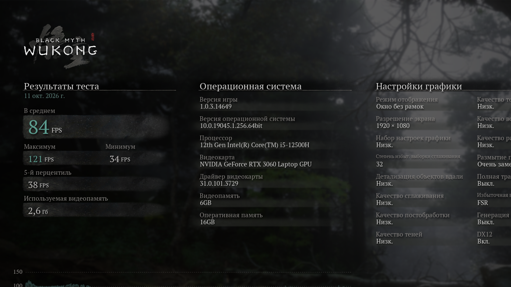
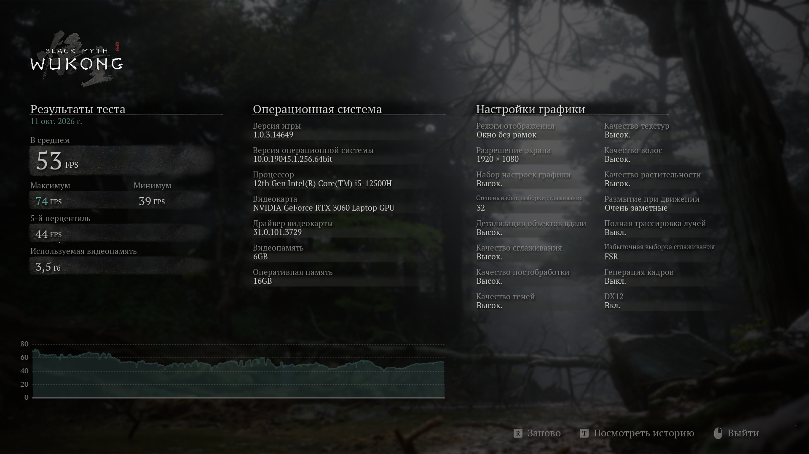

# Black Myth: Wukong Benchmark — результаты

## Тестовый компьютер

- РћРЎ: Windows 10 (64-bit)
- Процессор: Intel Core i5-12500H
- Видеокарта: NVIDIA GeForce RTX 3060 Laptop GPU
- Видеопамять: 6 GB
- Оперативная память: 16 GB
- Разрешение: 1920 × 1080

## Результаты

| Метрика | LOW | HIGH |
|---|---:|---:|
| Средний FPS | 107 | 53 |
| Максимальный FPS | 163 | 74 |
| Минимальный FPS | 65 | 39 |
| 5-й перцентиль FPS | 91 | 44 |

## Настройки графики

| Параметр | LOW | HIGH |
|---|---|---|
| QualityLevel | 1 | 3 |
| ImageQuality | 356 | 356 |
| SuperResolutionSampling | 0 | 0 |
| ViewDistance | 1 | 3 |
| AntiAliasing | 1 | 3 |
| PostProcessing | 1 | 3 |
| ShadowQuality | 1 | 3 |
| TextureQuality | 1 | 3 |
| FxQuality | 1 | 3 |
| MaterialQuality | 1 | 3 |
| VegetationQuality | 1 | 3 |
| GlobalIllumination | 1 | 3 |
| ReflectionQuality | 1 | 3 |
| InsertFrame | 0 | 0 |
| Rtx | 0 | 0 |
| RtxLevel | 1 | 1 |
| Dlss | 1 | 1 |
| Dx12 | 0 | 0 |
| MotionBlur | 2 | 2 |
| ScreenMode | 1 | 1 |
| ScreenRatio | 2 | 2 |
| ScreenResolution | 0 | 0 |
| Vsync | 0 | 0 |
| LockFrameRate | 0 | 0 |

## Скриншоты

### LOW

### HIGH

Примечание: LOW и HIGH — сценарии с низкими и высокими настройками графики соответственно.
